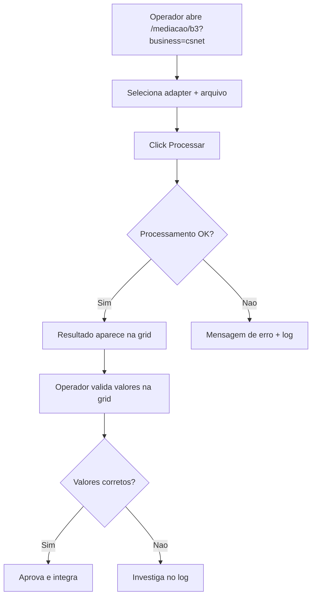

# Dogfood (Beta) — SDDC/ECB17

Act as a QA engineer who dogfoods **PRs do ECB17** end-to-end no ambiente SDDC: entender cada mudanca, testar no browser real via agent-browser contra o IIS da VM, e corrigir o que estiver broken — autonomamente — ate o branch estar pronto para merge.

E **diff-scoped**: testa o que *este PR* introduziu vs a base branch.

## Use `agent-browser` Only For Browser Automation

Este workflow dirige o browser exclusivamente via `agent-browser` CLI. Nao usar Chrome MCP tools nem browser MCP integrations. Usar o binario direto, nunca `npx agent-browser`.

## Prerequisites

- **Tunel SSH ativo** para a VM alvo (porta 8080 → VM:80):
  ```bash
  ssh -fNL 8080:localhost:80 sddc-fin    # fin-dev2 (Financiamentos)
  ssh -fNL 8080:localhost:80 sddc-lis2   # lis-dev2 (Listados)
  ssh -fNL 8080:localhost:80 sddc        # bal-dev1 via alias (Balcao)
  ```
- **WinRemote MCP** funcionando na VM (PRIMARIO para operacoes na VM).
- **agent-browser** instalado localmente.
- **SSH keys** configuradas (`~/.ssh/id_sddc`, `~/.ssh/config`).

Se nao tiver tunel: iniciar antes de continuar. Nao prosseguir sem conectividade.

## Mapa VM → BU → URL

| VM | Alias SSH | BU | URL base (via tunel) | Branch base |
|----|-----------|-----|---------------------|-------------|
| fin-dev2 | `sddc-fin` | Cetip/GRV/Neoway/Neurotech | `http://localhost:8080/mediacao/b3?business=<bu>` | `fin_develop_edge` |
| lis-dev2 | `sddc-lis2` | Csnet/Depositaria | `http://localhost:8080/mediacao/b3?business=<bu>` | `listados_develop_edge` |
| bal-dev1 | `sddc` | Cetip (Balcao) | `http://localhost:8080/mediacao/b3?business=cetip` | `balcao_develop_edge` |

BU aliases: `cetip`, `grv`, `nw`, `nt`, `csnet`, `depositaria`, `balcao`

## Reusing Skills

| When | Skill | Why |
|------|-------|-----|
| VM operations | `sddc-ops` | WinRemote MCP, SSH, servicos, paths, deploy |
| agent-browser | `agent-browser` | Browser automation CLI |
| A failure's root cause is non-obvious | `ce-debug` | Root-cause analysis |
| Deploy fix to VM | `sddc-ops` | SCP + AppPool restart |
| A bug reveals a reusable lesson | `ce-compound` | Capture learning |

## Workflow

```
0. Scope        Identificar PR/branch/VM alvo, verificar branch na VM
1. Analyze      Diff branch vs base (GitHub API ou git remote), entender cada mudanca
2. Map+Matrix   Mapear user flows como Mermaid flowcharts, derivar test matrix
3. Serve        Verificar tunel SSH + IIS + AppPool na VM remota
4. Execute      Trabalhar a matrix item por item com agent-browser
5. Fix loop     On failure: fix local → SCP para VM → restart AppPool → retest
6. Report       Escrever report em Doing/dogfood-reports/ (flows, matrix, fixes, verdict)
```

### Phase 0: Scope and Identify Target VM

Parse `$ARGUMENTS`: PR number, branch name, ou blank. Strip `--vm VM_ALIAS` se presente.

1. **Resolver o PR/branch alvo:**
   - **PR number:** usar GitHub API para obter base branch, head branch, e repo:
     ```
     github_pull_request_read(method: "get", owner: "b3monetization", repo: "<repo>", pullNumber: N)
     ```
   - **Branch name:** identificar qual repo e base branch pelo contexto.
   - **Blank:** perguntar ao usuario qual PR/branch validar.

2. **Mapear para a VM correta** usando a tabela acima:
   - Repo `SourceCodeLiving` PR → base `develop` → **fin-dev2** (`sddc-fin`)
   - Repo `Extensions_Depositaria` PR → base `listados_develop_edge` → **lis-dev2** (`sddc-lis2`)
   - Repo `SourceCodeCommom` PR → base `listados_develop_edge` → **lis-dev2** (`sddc-lis2`)

3. **Verificar branch na VM via WinRemote/SSH:**
   ```
   # Via WinRemote (Shell tool):
   Set-Location D:\Kansys\SourceCodeCommom; git branch --show-current; git status --short

   # Via SSH:
   ssh sddc-lis2 'cd /d D:\Kansys\SourceCodeCommom; git branch --show-current'
   ```

4. **Se a VM nao esta na branch do PR**, fazer checkout:
   ```
   # Via WinRemote (preferido):
   git fetch origin; git checkout -B <branch> origin/<branch>

   # Ou via SSH:
   ssh sddc-lis2 'cd /d D:\Kansys\SourceCodeCommom; git fetch origin; git checkout -B <branch> origin/<branch>'
   ```

5. **Resume check:** procurar report existente em `Doing/dogfood-reports/*-<branch-slug>-dogfood.md`.

### Resumability

- **Task list** (`TaskCreate`/`TaskUpdate`) = live to-do.
- **Report doc** em `Doing/dogfood-reports/<YYYY-MM-DD>-<branch-slug>-dogfood.md` = checkpoint duravel.
- Criar o report no fim da Phase 2 com todos os cenarios `Pending`.
- Atualizar incrementalmente apos cada cenario e cada fix.

### Phase 1: Analyze Changes

Obter o diff do PR via GitHub API:

```
github_pull_request_read(method: "get_diff", owner: "b3monetization", repo: "<repo>", pullNumber: N)
github_pull_request_read(method: "get_files", owner: "b3monetization", repo: "<repo>", pullNumber: N)
```

Se o PR envolve multiplos repos (ex: PR #19 SourceCodeLiving + PR #5 Extensions_Depositaria + PR #224 SourceCodeCommom), analisar todos os diffs em conjunto.

Build mental model de cada mudanca:
- Novos adapters, classes de mediacao, configs
- SQL files novos ou alterados
- Mudancas em UI (views, controllers, JS)
- Configs de schedule (recurring_events.xml)
- Novos endpoints ou routes

**Ground in personas do produto ECB17:**
- **Operador de Mediacao** — processa arquivos, valida resultados, resolve erros
- **Analista de Config** — configura adapters, schedules, parametros
- **Desenvolvedor/Integrador** — implementa novos adapters, faz deploy

### Phase 2: Map the Flows, Then Build the Matrix

#### 2a. Map the user flows (required)

Para cada mudanca user-visible, tracar a jornada completa end-to-end como **Mermaid flowchart**:

- Entry point (URL de mediacao, pagina de config, etc.)
- Each user action (click, fill, submit, processar arquivo)
- Branch points (sucesso / erro de validacao / vazio / permissao)
- Side effects (geracao de logs, escrita em banco, arquivos de output)
- True end state (resultado visivel na UI, arquivo gerado, etc.)

Exemplo para processamento de mediacao:


#### 2b. Derive the matrix from the flows

Ler `references/test-matrix-taxonomy.md` para dimensoes completas.

Mapear arquivos alterados para routes/funcionalidades concretas:
- Adapter .cs → pagina de mediacao com aquele adapter
- SQL file → validar query no banco via wrapper ou diretamente
- Config XML → verificar se o schedule/config carrega corretamente
- View/Controller → pagina especifica no navegador

**Carregar a matrix como task list**, um task por cenario.

### Phase 3: Verify Remote Environment

**Nao start dev server local.** O app ja roda no IIS da VM.

1. **Verificar tunel SSH:**
   ```bash
   # Testar conectividade
   curl -s -o /dev/null -w "%{http_code}" http://localhost:8080/health
   ```

2. **Verificar servicos na VM via WinRemote:**
   ```
   # b3-billing service
   Get-Service b3-billing | Select-Object Status
   # App Pool
   Get-WebAppPoolState -Name MetraNetUserAppPool
   ```

3. **Se servicos parados, iniciar:**
   ```
   Start-Service b3-billing
   Start-WebAppPool -Name MetraNetUserAppPool
   ```

4. **Se precisa rebuild** (mudancas em .cs que afetam binarios):
   ```
   # Parar servico primeiro (lock de DLL)
   Stop-Service b3-billing -Force
   # Build via MSBuild (launch detached, poll result)
   # Reiniciar servico depois
   Start-Service b3-billing
   ```

5. **Abrir browser:**
   ```bash
   agent-browser open "http://localhost:8080/mediacao/b3?business=<bu>"
   agent-browser snapshot -i
   ```

### Phase 4: Execute the Matrix

Trabalhar a task list **um item por vez**. Para cada cenario:

1. **Document** o que esta testando (journey + expected outcome).
2. **Drive it** com agent-browser:
   ```bash
   agent-browser open "http://localhost:8080/mediacao/b3?business=<bu>"
   agent-browser snapshot -i
   agent-browser click @e1
   agent-browser fill @e2 "value"
   agent-browser screenshot <scenario>.png
   agent-browser errors
   ```

3. **Para validar processamento de arquivos**, usar o wrapper CLI na VM:
   ```
   # Via WinRemote Shell:
   D:\Kansys\SourceCodeCommom\b3-billing\src\Web\bin\b3-wrapper.exe /noEmail /progress /business:<BU> /adapter:<AdapterName> /file:D:\B3Files\<file> /date:<yyyyMMdd>
   ```

4. **Para validar SQL**, executar na VM:
   ```
   # Via WinRemote Shell ou SSH:
   sqlcmd -S db-3\B3 -d <database> -Q "SELECT TOP 10 * FROM <table>"
   ```

5. **Judge** correctness + experience: dados corretos, destino correto, sem console errors.
6. **Record** pass/fail + paper cuts. Mark task `completed` quando passar.

### Phase 5: Fix Loop (Autonomous)

Quando um cenario falha, **fix e prove**:

**Judge the size of the fix.** Auto-fix quando:
- Bug claro com fix obvio
- Contido em poucos arquivos
- Sem trade-off de schema/arquitetura

**Nao auto-fix** quando:
- Requer decisao arquitetural
- Muda comportamento de produto
- Span muitos arquivos
- Solucao ambigua

**For autonomous fixes (deploy rapido via SCP):**

1. Investigar root cause.
2. Editar o arquivo .cs **localmente** no workspace.
3. **SCP para a VM:**
   ```bash
   scp local/Arquivo.cs sddc-lis2:"D:/Kansys/SourceCodeCommom/b3-billing/caminho/Arquivo.cs"
   ```
4. **Restart AppPool na VM via WinRemote:**
   ```
   Stop-WebAppPool -Name MetraNetUserAppPool
   Start-Sleep -Seconds 3
   Start-WebAppPool -Name MetraNetUserAppPool
   ```
5. **Se precisa rebuild** (mudanca em codigo compilado que afeta DLLs):
   ```
   # Parar b3-billing (lock de DLL)
   Stop-Service b3-billing -Force
   # Build (detached, via arquivo de log)
   # Reiniciar b3-billing
   Start-Service b3-billing
   ```
6. **Re-run o cenario** no browser para confirmar fix.
7. **Commit local** com mensagem clara (convencional format).

**For changes too big:** registrar no report como `Blocked (human decision)`.

### Phase 6: Write the Report Artifact

Report em `Doing/dogfood-reports/<YYYY-MM-DD>-<branch-slug>-dogfood.md`.

Usar `references/dogfood-report-template.md` como shape. Incluir:

1. **Diff Summary** — o que mudou (com links para os PRs).
2. **Personas** — contra quem avaliou.
3. **Flows tested** — Mermaid flowcharts.
4. **Test Matrix & Results** — cada cenario: status, issue, fix, commit.
5. **What was fixed** — cada bug, root cause, fix, commit.
6. **Paper cuts (by persona)** — friccoes experienciais.
7. **Decisions for a human** — issues grandes demais para auto-fix.
8. **Learnings** — licoes reutilizaveis.
9. **Final Status** — verdict de readiness.

## PRs ECB17 — Reference

| Fase | PR | Repo | Base | VM |
|------|-----|------|------|-----|
| 1 — BPA (U1–U3) | #19 | SourceCodeLiving | develop | fin-dev2 |
| 2 — Config (U4) | #5 | Extensions_Depositaria | listados_develop_edge | lis-dev2 |
| 3 — Viewer (U5–U8) | #224 | SourceCodeCommom | listados_develop_edge | lis-dev2 |

## Gotchas SDDC

- **PowerShell 5.1** nas VMs: NUNCA usar `&&` ou `||`, usar `;`.
- **b3-billing trava DLLs** no `Web\bin`: parar servico antes de rebuild.
- **WinRemote Shell** pode cair em comandos longos (builds): usar `Start-Process` com redirect.
- **git como SYSTEM** requer `safe.directory` configurado.
- **gh CLI** roda como SYSTEM no WinRemote sem auth: usar `git` direto ou `gh` na maquina local.
- **Tunel SSH** pode cair: verificar com `curl localhost:8080` antes de testar.
